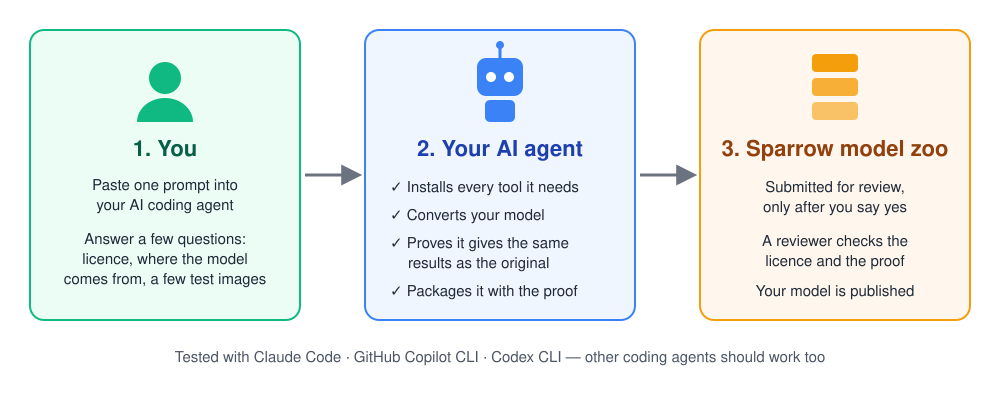
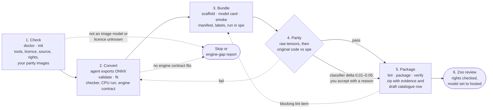

# Sparrow Model Zoo Uploader

**An agent toolkit for putting your model in the Sparrow model zoo.** Give an AI coding agent
one prompt. It installs the tools it needs, converts your image model to a
[Sparrow Engine](https://github.com/microsoft/SPARROW-Engine) bundle, proves the converted model
gives the same results as the original, packages it with that proof, and submits it to the
Sparrow model zoo for review. You answer a few questions; you do not need to install anything
or write code.



It works as a plugin or skill for coding agents. It has been run end to end with
**Claude Code**, **GitHub Copilot CLI** and **OpenAI Codex CLI**. Other agents that can run
shell commands and read files (Gemini CLI, Cursor and others) should also work.

**Supported models:** image **detectors**, **classifiers** and **image encoders** (camera-trap,
overhead, marine or general images). Sparrow Engine also runs audio models; this version of the
uploader does not package them yet. Video models are not supported by the engine.

There are two ways to use it:

1. **[Let your agent do everything](#quick-start-let-your-agent-do-it)** (recommended). You need
   only an AI coding agent.
2. **[Run the command-line tool yourself](#manual-workflow-command-line)**, for developers who
   want to drive each step.

For what to prepare and how the zoo review works, read the [submission guide](docs/user-guide.md).

## Quick start: let your agent do it

### What you need

- **An AI coding agent** that can run commands on your computer, for example
  [Claude Code](https://docs.anthropic.com/en/docs/claude-code),
  [GitHub Copilot CLI](https://github.com/features/copilot/cli) or
  [Codex CLI](https://github.com/openai/codex). Nothing else needs to be installed first: the
  agent installs Python, the uploader and the Sparrow Engine for you.
- **Your model**: a download link, a file on your computer, or the name of a public model.
- **The licence of the model weights** (any licence; the zoo reviewer decides how to host it).
- **10–50 of your own images** the model should work on (recommended; the agent uses them to
  prove the converted model matches the original).
- **A free [Hugging Face](https://huggingface.co/join) account**, only for the final submission.
  The agent checks whether you have one and walks you through it.

### Start

Open your agent in an empty folder and paste this prompt, with your model filled in:

```text
Get https://github.com/microsoft/SPARROW-Model-Zoo-Uploader and follow its skill,
skills/sparrow-model-uploader/SKILL.md, to convert my model and submit it to the
Sparrow model zoo. Set up every tool you need yourself, explain each step to me in
plain words, and ask me before installing anything that needs administrator rights.

My model: <download link, file path, or model name>
```

That is the whole setup. The agent reads the skill in this repository and takes it from there.

### What happens next

| The agent does | You do |
|---|---|
| Installs [uv](https://docs.astral.sh/uv/) (which brings Python), the `sparrow-uploader` tool and the Sparrow Engine, then checks they work | Say yes to the installs |
| Asks about your model: where it comes from, its licence, who made it, what it detects or classifies | Answer the questions |
| Converts the model to ONNX and builds the engine bundle | Nothing |
| Runs the original and the converted model on your images and compares the results | Point it to your images |
| Writes the model card and packages everything with the evidence | Read and correct the model card |
| Checks your Hugging Face login, shows exactly what will be uploaded, and submits only after you confirm | Log in to Hugging Face yourself, then say yes |
| Reports the zoo reviewer's comments and fixes what they ask for | Nothing, unless asked |

If a check fails, the agent fixes the cause and runs it again; it is not allowed to loosen a
check to get a pass. If the engine cannot run your kind of model, the agent stops and drafts a
report for the Sparrow Engine team instead.

The agent never needs your Hugging Face token in the chat. When it is time to submit, it asks
you to log in yourself in a terminal.

### Optional: install as a plugin

Installing the skill as a plugin lets you skip the long prompt and just say *"Help me submit my
model to the Sparrow model zoo."* Pick the command for your agent:

```bash
# Claude Code
claude plugin marketplace add microsoft/SPARROW-Model-Zoo-Uploader
claude plugin install sparrow-model-uploader

# GitHub Copilot CLI
copilot plugin install microsoft/SPARROW-Model-Zoo-Uploader

# Gemini CLI (extension format checked against the docs, not yet run end to end)
gemini extensions install https://github.com/microsoft/SPARROW-Model-Zoo-Uploader

# Any agent that reads a skills folder, once the CLI is installed (see below)
sparrow-uploader install-skill --target claude     # ~/.claude/skills
sparrow-uploader install-skill --target copilot    # ~/.copilot/skills
sparrow-uploader install-skill --target codex      # ~/.agents/skills
sparrow-uploader install-skill --dest /path/to/skills
```

### For AI agents reading this

Start at [`skills/sparrow-model-uploader/SKILL.md`](skills/sparrow-model-uploader/SKILL.md) and
follow its stages in order. Stage S0 sets up the user's environment from nothing. Use the
`sparrow-uploader` commands for every check; do not write your own. Ask before any install that
needs administrator rights, and never ask the user to paste a token into the conversation.

## How it works

The repository contains two parts:

- **The agent skill** (`skills/sparrow-model-uploader/`). It tells the agent what to ask you, how
  to convert your model to ONNX, which checks to run, and what to do when a check fails.
  Third-party models differ a lot in framework, preprocessing and output format, so the
  conversion itself is agent work.
- **The `sparrow-uploader` command-line tool.** It runs the fixed checks the same way for every
  model: ONNX validation, engine manifest generation, a run in the real engine, parity against
  the original model, bundle lint, packaging, verification and submission. Every command writes
  an evidence file, and the submission package carries that evidence to the zoo reviewer.

The agent calls the tool for every check. The steps:



Each step writes `.sparrow-upload/<model_id>/evidence/<step>.json` with a result of `pass`,
`warn`, `fail` or `skipped`. Dotted arrows show early exits and where the agent goes back when a check fails. A failed gate is
fixed at its cause; the skill forbids loosening a threshold to get a pass.

## Manual workflow (command line)

Use this if you want to run each step yourself, or to script the uploader. The agent runs the
same commands.

### Requirements

- Python 3.11–3.13 and [uv](https://docs.astral.sh/uv/).
- Sparrow Engine's `spe` command, version 0.1.30. It is not on PyPI (the `sparrow-engine` wheel
  there is the Python API only). Install it with
  `brew install microsoft/sparrow-engine/sparrow-engine`, or download
  `sparrow-engine-cpu-0.1.30-<platform>.tar.gz` from the
  [v0.1.30 release](https://github.com/microsoft/SPARROW-Engine/releases/tag/v0.1.30), extract
  it and put its `bin/` on `PATH`.
- The licence of your model **weights**.
- 10–50 of your own images the model should work on (recommended; see the guide).

### Install

The command-line tool (not on PyPI yet; install from this repository):

```bash
uv tool install git+https://github.com/microsoft/SPARROW-Model-Zoo-Uploader
sparrow-uploader doctor
```

Models whose source is PyTorch or Ultralytics need the optional extra for the raw-parity check:

```bash
uv tool install 'sparrow-model-uploader[ultralytics] @ git+https://github.com/microsoft/SPARROW-Model-Zoo-Uploader'
```

The extra installs Ultralytics (AGPL-3.0) into your environment for conversion only. It does not
change the uploader's MIT licence. A model converted with it gets `AGPL-3.0` in its bundle's
framework licences. Extras combine: `[ultralytics,submit]`.

### Run the steps
```bash
M=my-deer-detector
sparrow-uploader init --model-id $M --task detector --domain camera_trap --license MIT \
  --source https://example.org/weights --developer "My Lab" --reference https://doi.org/... \
  --description "Deer detector" --submitter my-hf-user --parity-data ./my_images \
  --rights-holder "My Lab" --license-url https://example.org/LICENSE \
  --display-name "My Deer Detector" --source-weights ./downloaded/weights.pt
sparrow-uploader validate --model-id $M model.onnx
sparrow-uploader fit --model-id $M
sparrow-uploader scaffold --model-id $M --labels labels.txt --license-file LICENSE.txt \
  --preprocess letterbox --normalization unit --interpolation cv2_bilinear \
  --family MyFamily --version v1 --geo-scope regional --geo-regions north_america
# edit the bundle's MODEL_CARD.md and replace every TODO
sparrow-uploader smoke --model-id $M
sparrow-uploader parity raw --model-id $M --source-torchscript model.pt
sparrow-uploader parity pipeline --model-id $M --reference reference_predictions.json
sparrow-uploader lint --model-id $M
sparrow-uploader package --model-id $M --out dist
sparrow-uploader verify dist/$M-submission.zip
```

Every command prints JSON on stdout. Exit codes: `0` pass or warn, `1` gate failed, `2` usage or
input error. `sparrow-uploader <command> --help` lists all options;
`sparrow-uploader capabilities` lists what the installed engine can run.

### Submit

`submit` opens a pull request with the zip on the Hugging Face repository
[`ai-for-good-lab/sparrow-model-zoo-submission`](https://huggingface.co/ai-for-good-lab/sparrow-model-zoo-submission).
It needs the `[submit]` extra and a Hugging Face **Write** token
([settings/tokens](https://huggingface.co/settings/tokens)) in `HF_TOKEN` or from `hf auth login`.

```bash
uv tool install 'sparrow-model-uploader[submit] @ git+https://github.com/microsoft/SPARROW-Model-Zoo-Uploader'
sparrow-uploader submit --model-id my-detector --dry-run          # what would be uploaded
sparrow-uploader submit --model-id my-detector --confirm-public   # open the pull request
sparrow-uploader status --model-id my-detector                    # review state and comments
```

The pull request and its files are **public** as soon as they are uploaded, before any review.
Submit only weights you are allowed to redistribute. Pull requests are never merged: the zoo
admin reviews the submission, publishes approved models through the zoo's release process,
comments the decision and closes the pull request. To answer review comments, fix the bundle,
re-run `package`, then `submit --pr <number> --confirm-public` to push a new revision to the same
pull request. See the [submission guide](docs/user-guide.md) for what the reviewer checks.

## What gets checked

| Check | Command | Passes when |
|---|---|---|
| ONNX is valid and portable | `validate` | `onnx.checker` passes, loads in onnxruntime CPU, opset ≥ 17, no external data, no custom ops |
| Engine can run it | `fit`, `smoke` | output layout matches an engine contract; `spe` runs the bundle with sane outputs |
| Conversion is exact | `parity raw` | max abs delta ≤ 1e-3 and cosine ≥ 0.999999 against the original model |
| Preprocessing matches | `parity pipeline` | detectors: every detection matched (IoU ≥ 0.5); classifiers: same top-1, probability delta ≤ 0.01 (0.01–0.05 needs your decision); encoders: cosine ≥ 0.99 |
| Bundle is complete | `lint` | labels, licence text, filled-in model card, unique id, zoo compliance files |

Details: [parity gates](skills/sparrow-model-uploader/references/parity-gates.md).

## What is in the submission package

`<model_id>-submission.zip` contains:

- the engine bundle: `manifest.toml`, `1/model.onnx`, `labels.txt`, `MODEL_CARD.md`,
  `LICENSE.md`, and the generated `ATTRIBUTION.md`, `CONVERSION.md`, `SOURCE.md`,
  `SOURCE_ARTIFACT.json`;
- the evidence file from every step and your reference predictions;
- `submission.json`: a draft zoo catalogue row with the rights fields, tool versions and the
  sha256 of every file. It is marked `hosting_status = "pending_rights"`, and its
  `review_required` block lists the fields the zoo reviewer sets on approval.

It never contains your parity images, your email address, or local file paths.

## Contributing

See [CONTRIBUTING.md](CONTRIBUTING.md) for the code layout, conventions and the Contributor
License Agreement. Report bugs on [GitHub Issues](SUPPORT.md).

## Trademarks

This project may contain trademarks or logos for projects, products, or services. Authorized use
of Microsoft trademarks or logos is subject to and must follow
[Microsoft's Trademark & Brand Guidelines](https://www.microsoft.com/legal/intellectualproperty/trademarks/usage/general).
Use of Microsoft trademarks or logos in modified versions of this project must not cause
confusion or imply Microsoft sponsorship. Any use of third-party trademarks or logos are subject
to those third-party's policies.

## License

MIT. See [LICENSE](LICENSE). Models you package keep their own licence.
